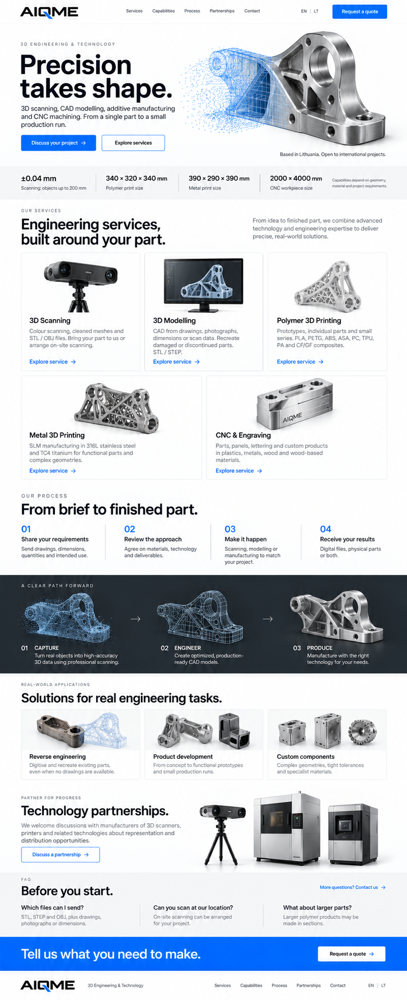
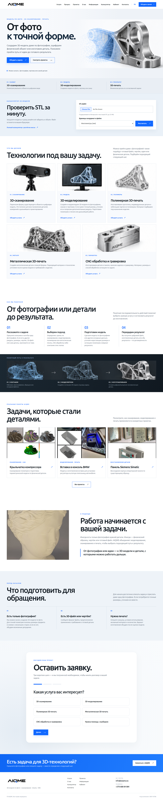

# Сверка AIQME с макетом Excel

Дата: 29 сентября 2026. Основа сравнения — последний светлый макет `xl/media/image5.png` из `materials/design_inside_excel.xlsx`. Сравнивал его с главной страницей после сборки при ширине 1440 px; снимок сайта уменьшен до ширины макета (801 px). Проверил мобильную ширину 390 px отдельно.

## Совпадает

- Светлая основа, синий акцент, крупная тёмная типографика и логотип AIQME.
- Композиция первого экрана: текст слева, металлическая деталь и синяя сетка справа.
- Три ключевые иллюстрации услуг взяты из этого же макета.
- Все пять карточек услуг теперь на месте: три в первом ряду и две во втором. Изображения металлической печати и CNC также взяты из Excel.
- После сверки этапы работы размещены на белом фоне, а иллюстрация перехода от скана к детали — в отдельной тёмной полосе.
- Подвал страницы теперь светлый, как в макете. Синий призыв к обращению расположен непосредственно над ним.

## Осознанные отличия

- Вместо числовых характеристик оборудования из макета показаны направления работы. Числа требуют проверки владельцем AIQME.
- В макете есть блок о технологическом партнёрстве. Сейчас на этом месте блок о подходе с фотографией реальной работы AIQME; партнёрский текст требует подтверждения.
- Блок проектов показывает реальные работы AIQME, поэтому отличается от концептуальных изображений деталей в Excel.
- Навигация дополнена калькулятором и кабинетом клиента по требованиям проекта.
- На главной появились короткий STL-калькулятор и форма заявки из трёх шагов. Их нет в исходном Excel: они добавлены по последующим требованиям.

Эти отличия меняют длину и структуру страницы: это адаптация визуального языка макета к согласованному содержанию, а не его попиксельная копия.
